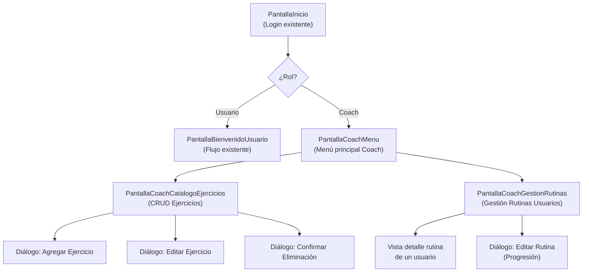

# 📋 Descripción del Problema — Módulo Coach (PSP1)

## 1. Enunciado del Problema

**Sistema:** FitGuide — Sistema de Entrenamiento Progresivo  
**Módulo:** Gestión de Ejercicios y Rutinas por parte del Coach  
**Autor:** Equipo FitGuide — UACM  
**Fecha:** 23 de octubre de 2026  

---

### 1.1 Contexto

FitGuide es una aplicación de escritorio desarrollada en **Java 21 con JavaFX** que permite a los usuarios configurar y ejecutar rutinas de ejercicio personalizadas. Actualmente, los ejercicios están codificados directamente en la clase `CatalogoEjercicios.java` (hardcoded), lo cual impide agregar, editar o eliminar ejercicios sin modificar el código fuente.

Se requiere un **módulo para el rol de Coach** que permita gestionar dinámicamente el catálogo de ejercicios y las rutinas asignadas a los usuarios, habilitando un entrenamiento progresivo.

### 1.2 Declaración del Problema

> *Se necesita diseñar e implementar un módulo de Coach dentro del sistema FitGuide que permita:*
>
> 1. **Visualizar** el catálogo completo de ejercicios almacenados en la base de datos.
> 2. **Agregar** nuevos ejercicios al catálogo con todos sus atributos (nombre, zona corporal, nivel, tipo de peso, repeticiones, series, duración, descanso, descripción, imagen y video).
> 3. **Editar** los atributos de ejercicios existentes.
> 4. **Eliminar** ejercicios del catálogo.
> 5. **Ver las rutinas** asignadas a cada usuario.
> 6. **Editar las rutinas de los usuarios** para implementar un esquema de entrenamiento progresivo (incrementar repeticiones, series, peso, cambiar nivel).
>
> *El módulo debe integrarse al sistema existente respetando la arquitectura MVC + DAO con JavaFX/FXML y la base de datos SQLite, y debe seguir la convención de nombres **PascalCase** para clases y **camelCase** para métodos y variables.*

---

## 2. Descripción de la Interfaz

### 2.1 Pantallas del Módulo Coach

### 2.2 Pantalla Coach — Catálogo de Ejercicios

| Zona de la Pantalla | Componente | Descripción |
|---|---|---|
| **Barra Superior** | `Label` + `Button` | Título "Catálogo de Ejercicios" + botón "Regresar al Menú" |
| **Filtros** | `ComboBox` × 3 | Filtrar por: Zona Corporal, Nivel, Tipo de Peso |
| **Tabla Principal** | `TableView<EjercicioCoach>` | Columnas: ID, Nombre, Zona, Nivel, Tipo Peso, Reps, Series, Descripción |
| **Botones de Acción** | `Button` × 3 | "Agregar", "Editar", "Eliminar" |
| **Barra de Búsqueda** | `TextField` | Búsqueda por nombre de ejercicio |

### 2.3 Pantalla Coach — Gestión de Rutinas de Usuarios

| Zona de la Pantalla | Componente | Descripción |
|---|---|---|
| **Barra Superior** | `Label` + `Button` | Título "Rutinas de Usuarios" + botón "Regresar al Menú" |
| **Lista de Usuarios** | `TableView<Usuario>` | Nombre, ID |
| **Rutinas del Usuario** | `TableView<RutinaUsuario>` | Grupo muscular, Nivel, Tipo peso, Series, Descanso |
| **Detalle de Rutina** | `TableView<Ejercicio>` | Ejercicios dentro de la rutina seleccionada |
| **Botón Editar** | `Button` | "Editar Rutina para Progresión" |

### 2.4 Diálogo de Progresión de Rutina

| Campo | Tipo | Descripción |
|---|---|---|
| Series | `Spinner<Integer>` | Incrementar/decrementar series (1–10) |
| Tiempo de Descanso | `Spinner<Integer>` | Ajustar descanso en segundos (10–300) |
| Peso Extra | `TextField` | Modificar peso en kg |
| Repeticiones por ejercicio | `TextField` × N | Editar repeticiones de cada ejercicio |

---

## 3. Entradas y Salidas del Módulo

### 3.1 Entradas

| Entrada | Fuente | Tipo |
|---|---|---|
| Datos del ejercicio | Coach (formulario) | `String`, `int`, `double` |
| ID del ejercicio a editar/eliminar | Selección en tabla | `int` |
| ID del usuario para ver rutinas | Selección en tabla | `int` |
| Parámetros de progresión | Coach (formulario) | `int`, `double`, `Map<String,Integer>` |
| Credenciales de Coach | Pantalla login | `String` (usuario + contraseña) |

### 3.2 Salidas

| Salida | Destino | Tipo |
|---|---|---|
| Ejercicio creado/editado | Base de datos SQLite | `INSERT`/`UPDATE` |
| Ejercicio eliminado | Base de datos SQLite | `DELETE` |
| Rutina actualizada (progresión) | Base de datos SQLite | `UPDATE` |
| Lista de ejercicios filtrada | `TableView` en pantalla | `ObservableList<EjercicioCoach>` |
| Lista de rutinas por usuario | `TableView` en pantalla | `ObservableList<RutinaUsuario>` |
| Mensajes de confirmación/error | `Alert` en pantalla | `String` |

---

## 4. Restricciones y Supuestos

> [!IMPORTANT]
> - El módulo Coach es **independiente** del flujo del usuario existente. Los compañeros del equipo se encargarán de la integración con el login y la navegación general.
> - El Coach **NO** ejecuta rutinas; solo las administra.
> - La base de datos SQLite es compartida; el módulo usará las tablas existentes (`usuarios`, `rutinas_guardadas`, `historial_rutinas`, `historial_ejercicios`) y creará una nueva tabla `ejercicios_catalogo` para el catálogo persistente.

> [!NOTE]
> - Se asume que el Coach accede desde la misma aplicación de escritorio.
> - La autenticación del Coach se diferencia del usuario normal mediante un campo `rol` en la tabla `usuarios` (a integrar por los compañeros).
