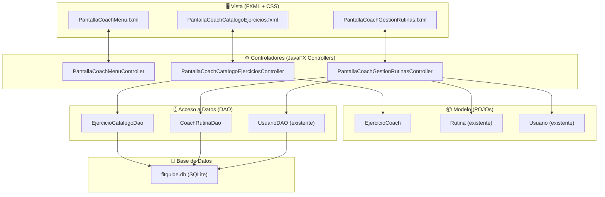
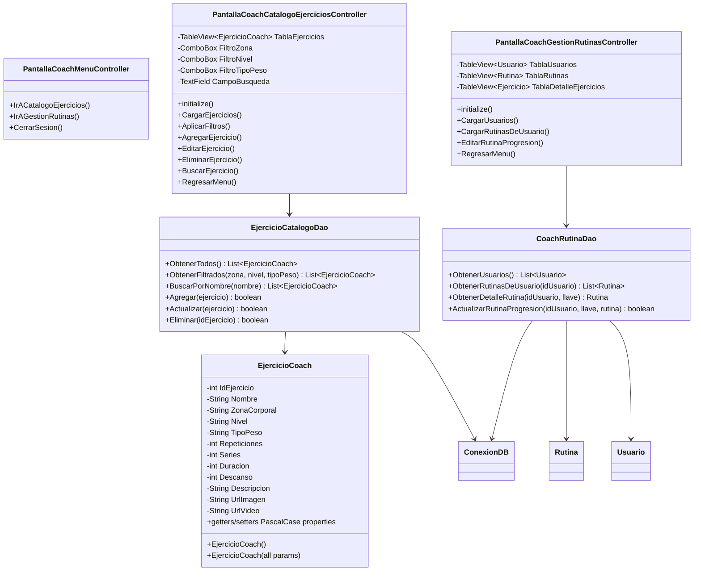
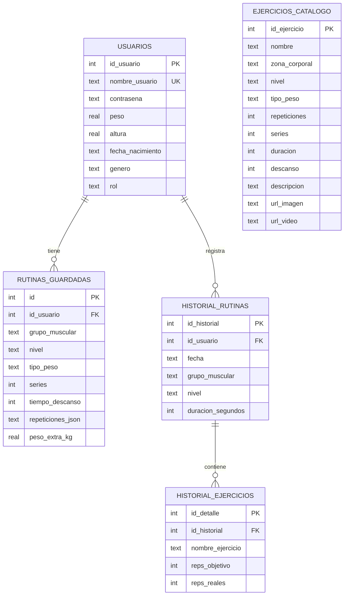
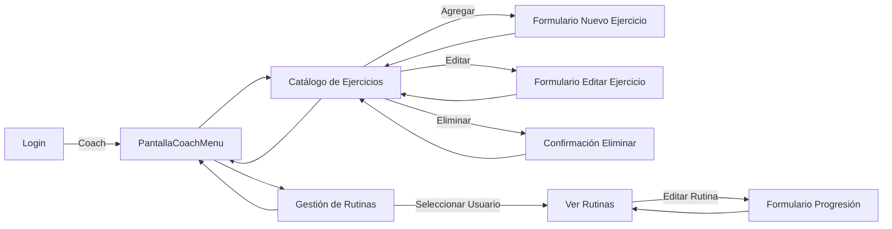

# 🏗️ Diseño Conceptual de Alto Nivel — Módulo Coach (PSP1)

**Proyecto:** FitGuide  
**Módulo:** Coach — Gestión de Ejercicios y Rutinas  
**Fecha:** 23 de octubre de 2026  

---

## 1. Arquitectura General del Sistema



---

## 2. Diagrama de Clases del Módulo Coach



---

## 3. Diagrama Entidad-Relación (Extendido)



> [!NOTE]
> La tabla `ejercicios_catalogo` es **nueva** y reemplaza al catálogo hardcoded de `CatalogoEjercicios.java`. La tabla `usuarios` se extiende con un campo `rol` (TEXT) que distingue entre "usuario" y "coach".

---

## 4. Flujo de Navegación



---

## 5. Estructura de Archivos del Módulo

```
src/main/java/omr/uacm/sistemafitguide/
├── EjercicioCoach.java                              ← Modelo (POJO)
├── EjercicioCatalogoDao.java                        ← DAO para CRUD de ejercicios
├── CoachRutinaDao.java                              ← DAO para gestión de rutinas
├── PantallaCoachMenuController.java                 ← Controller menú Coach
├── PantallaCoachCatalogoEjerciciosController.java   ← Controller catálogo
├── PantallaCoachGestionRutinasController.java       ← Controller rutinas

src/main/resources/omr/uacm/sistemafitguide/
├── PantallaCoachMenu.fxml                           ← Vista menú
├── PantallaCoachCatalogoEjercicios.fxml             ← Vista catálogo
├── PantallaCoachGestionRutinas.fxml                 ← Vista rutinas
```

---

## 6. Patrones de Diseño Utilizados

| Patrón | Uso en el Módulo |
|---|---|
| **MVC** (Model-View-Controller) | Separación de FXML (Vista), Controllers (Controlador), y POJOs+DAOs (Modelo) |
| **DAO** (Data Access Object) | `EjercicioCatalogoDao` y `CoachRutinaDao` encapsulan el acceso a SQLite |
| **Singleton** | `ConexionDB` y `Sesion` (ya existentes) |
| **Observer** | JavaFX `ObservableList` para binding reactivo de tablas |

---

## 7. Convenciones de Estilo de Programación

### Estilo Principal: PascalCase

| Elemento | Convención | Ejemplo |
|---|---|---|
| Clases | PascalCase | `EjercicioCoach`, `CoachRutinaDao` |
| Métodos públicos | PascalCase | `ObtenerTodos()`, `AgregarEjercicio()` |
| Variables locales | camelCase | `listaEjercicios`, `ejercicioSeleccionado` |
| Campos privados | camelCase | `idEjercicio`, `zonaCorporal` |
| Constantes | UPPER_SNAKE_CASE | `ESTILO_TAB_ACTIVO` |
| FXML IDs | camelCase | `tablaEjercicios`, `btnAgregar` |
| Archivos FXML | PascalCase | `PantallaCoachMenu.fxml` |

> [!TIP]
> ### Segundo Estilo Recomendado: **camelCase Consistente (Java Standard)**
>
> Además de PascalCase para clases, les recomiendo combinar con **camelCase estricto** para todo lo demás (métodos, variables, parámetros). Este es el **estándar oficial de Java** (Java Code Conventions de Oracle/Sun).
>
> **¿Por qué?**
> - Es el estándar que toda la industria Java usa y espera.
> - JavaFX ya usa camelCase para sus propios métodos (`setOnAction`, `getChildren`).
> - Los IDEs (IntelliJ, NetBeans) generan código en camelCase por defecto.
> - Facilita la lectura cuando trabajas con las APIs existentes de Java.
>
> | Elemento | PascalCase (Clase) + camelCase (resto) |
> |---|---|
> | Clase | `EjercicioCoach` |
> | Método | `obtenerTodos()` |
> | Variable | `ejercicioSeleccionado` |
> | Constante | `ESTILO_ACTIVO` |
>
> Este combo (PascalCase clases + camelCase métodos) es lo que ya usan en la mayoría de su código existente, así que es el camino natural. 👍
